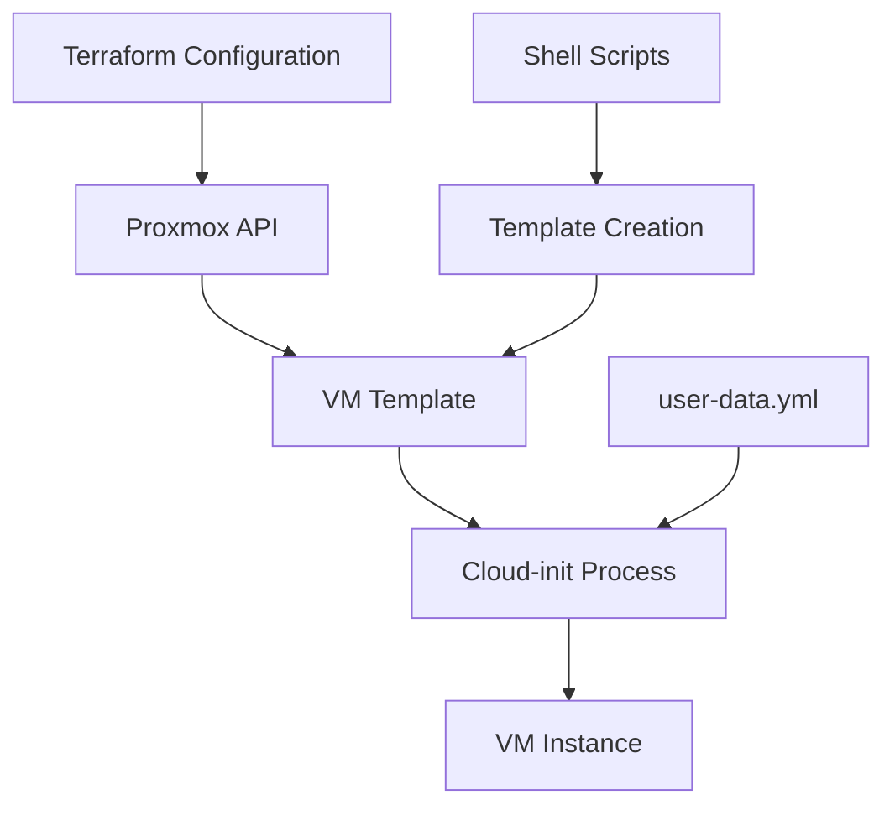

# 🚀 Linux Configuration Automation and IaC with Proxmox and Terraform

> **Automate VM creation and configuration using Infrastructure as Code principles**

[](https://terraform.io)
[](https://proxmox.com)
[](https://linux.org)

---

## 📋 Table of Contents

- [Overview](#-overview)
- [Architecture](#-architecture)
- [Prerequisites](#-prerequisites)
- [Project Structure](#-project-structure)
- [Configuration Guide](#-configuration-guide)
- [Usage Instructions](#-usage-instructions)
- [Advanced Features](#-advanced-features)
- [Troubleshooting](#-troubleshooting)

---

## 🎯 Overview

This project provides a comprehensive automation solution for creating and configuring virtual machines in Proxmox using **Terraform** and **Cloud-init**. The system streamlines infrastructure deployment through Infrastructure as Code (IaC) principles, ensuring consistent and reproducible VM configurations.

### 🌟 Key Features

- ✅ **Automated VM provisioning** with Terraform
- ✅ **Template-based deployment** for consistency
- ✅ **Cloud-init integration** for OS configuration
- ✅ **QEMU Guest Agent** setup and verification
- ✅ **Network configuration** automation
- ✅ **Multi-disk support** for data-intensive applications

---

## 🏗️ Architecture



<details>
<summary><strong>🔧 Component Breakdown</strong></summary>

| Component | Purpose | Technology |
|-----------|---------|------------|
| **Terraform** | Infrastructure as Code orchestration | HashiCorp Terraform |
| **Proxmox** | Virtualization platform | Proxmox VE |
| **Cloud-init** | VM initialization and configuration | Cloud-init |
| **Shell Scripts** | Template creation and testing | Bash |
| **QEMU Guest Agent** | VM-host communication | QEMU |

</details>

---

## 📦 Prerequisites

<details>
<summary><strong>🔍 System Requirements</strong></summary>

### Infrastructure Requirements
- **Proxmox VE** installed on physical or virtual server
- **API access** configured with appropriate tokens
- **Storage backend** (local-lvm or shared storage)
- **Network bridge** configured (vmbr0)

### Software Dependencies
- **Terraform** >= 1.0
- **Cloud-init** package
- **QEMU Guest Agent**
- **SSH access** to Proxmox host

### Access Requirements
- Proxmox API URL and credentials
- Sufficient privileges for VM creation
- Network connectivity to target infrastructure

</details>

---

## 📁 Project Structure

```
├── 📄 main.tf              # Primary Terraform configuration
├── 📄 variables.tf         # Variable definitions
├── 📄 user-data.yml        # Cloud-init configuration
├── 📄 create-template.sh   # Template creation script
└── 📄 README.md           # Project documentation
```

<details>
<summary><strong>📋 File Descriptions</strong></summary>

### Core Configuration Files

| File | Description | Purpose |
|------|-------------|---------|
| `main.tf` | Main Terraform configuration | Defines VM resources and infrastructure |
| `variables.tf` | Variable definitions | Customizable parameters for deployment |
| `user-data.yml` | Cloud-init configuration | OS initialization and package installation |
| `create-template.sh` | Shell automation script | Template creation and validation |

</details>

---

## ⚙️ Configuration Guide

### 1. 🔐 Proxmox Provider Setup

<details>
<summary><strong>Provider Configuration</strong></summary>

Configure your Proxmox connection in `variables.tf`:

```hcl
variable "pm_api_url" {
  description = "Proxmox API URL"
  type        = string
  default     = "https://your-proxmox-server:8006/api2/json"
}

variable "pm_api_token_id" {
  description = "Proxmox API Token ID"
  type        = string
  default     = "your-token-id"
}

variable "pm_api_token_secret" {
  description = "Proxmox API Token Secret"
  type        = string
  sensitive   = true
  default     = "your-token-secret"
}
```

</details>

### 2. 🖥️ VM Resource Configuration

<details>
<summary><strong>Main Terraform Configuration</strong></summary>

**Complete `main.tf` Configuration:**

```hcl
terraform {
  required_providers {
    proxmox = {
      source  = "telmate/proxmox"
      version = "~> 2.9"
    }
  }
}

provider "proxmox" {
  pm_api_url          = var.pm_api_url
  pm_api_token_id     = var.pm_api_token_id
  pm_api_token_secret = var.pm_api_token_secret
  pm_tls_insecure     = var.pm_tls_insecure
}

resource "proxmox_vm_qemu" "cloudinit-example" {
  vmid                 = 0
  name                 = var.vm_name
  target_node          = "pve"
  agent                = 1
  memory               = var.vm_memory
  boot                 = "order=scsi0"
  clone                = var.vm_clone
  scsihw               = "virtio-scsi-single"
  vm_state             = "running"
  automatic_reboot     = true
  cicustom             = "vendor=local:snippets/user-data.yml"
  ciupgrade            = true
  ipconfig0            = "ip=dhcp,ip6=dhcp"
  skip_ipv6            = true
  ciuser               = var.vm_ciuser
  cipassword           = var.vm_cipassword

  cpu {
    cores   = var.vm_cpu
    sockets = 1
    type    = "host"
  }

  serial {
    id = 0
  }

  disks {
    scsi {
      scsi0 {
        disk {
          storage = "local-lvm"
          size    = var.vm_root_disk_size
        }
      }
      scsi1 {
        disk {
          storage = "local-lvm"
          size    = var.vm_data_disk_size
        }
      }
    }
    ide {
      ide1 {
        cloudinit {
          storage = "local-lvm"
        }
      }
    }
  }

  network {
    id     = 0
    bridge = "vmbr0"
    model  = "virtio"
  }
}
```

</details>

### 3. ☁️ Cloud-init Setup

<details>
<summary><strong>Cloud-init Configuration</strong></summary>

**Complete `user-data.yml` Configuration:**

```yaml
#cloud-config
hostname: user
user: user
password: user
chpasswd: { expire: False }
ssh_pwauth: True
package_update: true
package_upgrade: true

packages:
  - qemu-guest-agent
  - ansible
  - curl
  - wget
  - htop
  - vim

write_files:
  - path: /etc/systemd/system/qemu-guest-agent.service
    content: |
      [Unit]
      Description=QEMU Guest Agent
      BindsTo=dev-virtio\x2dports-org.qemu.guest_agent.0.device
      After=dev-virtio\x2dports-org.qemu.guest_agent.0.device

      [Service]
      ExecStart=/usr/sbin/qemu-ga \
        --method=virtio-serial \
        --path=/dev/virtio-ports/org.qemu.guest_agent.0 \
        --blacklist=guest-file-open,guest-file-close,guest-file-read,guest-file-write,guest-file-seek,guest-file-flush
      Restart=always
      RestartSec=0

      [Install]
      WantedBy=multi-user.target

runcmd:
  - systemctl daemon-reload
  - systemctl enable qemu-guest-agent.service
  - systemctl start qemu-guest-agent.service
  - echo "Cloud-init configuration completed" >> /var/log/cloud-init-custom.log
```

</details>

---

## 🚀 Usage Instructions

### Step 1: 🏗️ Template Creation

<details>
<summary><strong>Automated Template Creation</strong></summary>

Run the template creation script:

```bash
chmod +x create-template.sh
./create-template.sh
```

**Script Functions:**
- ✅ Downloads base OS image
- ✅ Configures Cloud-init integration
- ✅ Installs QEMU Guest Agent
- ✅ Validates template functionality
- ✅ Prepares for Terraform deployment

</details>

### Step 2: 🔧 Terraform Initialization

<details>
<summary><strong>Infrastructure Deployment</strong></summary>

```bash
# Initialize Terraform
terraform init

# Validate configuration
terraform validate

# Plan deployment
terraform plan

# Apply configuration
terraform apply
```

**Deployment Process:**
1. 🔍 **Planning Phase** - Reviews infrastructure changes
2. 🚀 **Apply Phase** - Creates VM resources
3. ✅ **Validation Phase** - Confirms successful deployment

</details>

### Step 3: 🧪 Testing and Validation

<details>
<summary><strong>Post-Deployment Verification</strong></summary>

**Automated Checks:**
```bash
# Check VM status
terraform show

# Validate QEMU Guest Agent
proxmox-vm-test.sh

# Network connectivity test
ping -c 4 <vm-ip-address>
```

**Manual Verification:**
- SSH connectivity
- Service status verification
- Resource allocation confirmation
- Network configuration validation

</details>

---

## 🎛️ Advanced Features

<details>
<summary><strong>🔧 Customization Options</strong></summary>

### Variable Customization

| Variable | Description | Default | Type |
|----------|-------------|---------|------|
| `vm_name` | Virtual machine name | `"terraform-vm"` | string |
| `vm_memory` | RAM allocation (MB) | `2048` | number |
| `vm_cpu` | CPU core count | `2` | number |
| `vm_root_disk_size` | Root disk size | `"20G"` | string |
| `vm_data_disk_size` | Data disk size | `"50G"` | string |

### Multi-VM Deployment

```hcl
resource "proxmox_vm_qemu" "cluster_nodes" {
  count = var.vm_count
  name  = "${var.vm_name}-${count.index + 1}"
  # ... rest of configuration
}
```

</details>

<details>
<summary><strong>🔒 Security Enhancements</strong></summary>

### SSH Key Authentication

```yaml
# Add to user-data.yml
ssh_authorized_keys:
  - ssh-rsa AAAAB3NzaC1yc2EAAAA... user@hostname

# Disable password authentication
ssh_pwauth: False
```

### Firewall Configuration

```yaml
# Add to runcmd section
runcmd:
  - ufw enable
  - ufw default deny incoming
  - ufw default allow outgoing
  - ufw allow ssh
```

</details>

---

## 🔧 Troubleshooting

<details>
<summary><strong>🚨 Common Issues and Solutions</strong></summary>

### Issue: QEMU Guest Agent Not Starting

**Symptoms:**
- VM shows as "QEMU Guest Agent not running"
- Terraform cannot detect VM IP address

**Solution:**
```bash
# Check service status
systemctl status qemu-guest-agent

# Restart service
systemctl restart qemu-guest-agent

# Verify configuration
cat /etc/systemd/system/qemu-guest-agent.service
```

### Issue: Cloud-init Configuration Not Applied

**Symptoms:**
- Default hostname not changed
- Packages not installed
- User not created

**Solution:**
```bash
# Check cloud-init logs
sudo cloud-init status --long
sudo journalctl -u cloud-init

# Re-run cloud-init
sudo cloud-init clean
sudo cloud-init init
```

### Issue: Terraform Apply Failures

**Symptoms:**
- API connection timeouts
- Authentication errors
- Resource creation failures

**Solution:**
```bash
# Verify API connectivity
curl -k https://your-proxmox:8006/api2/json/version

# Check token permissions
# Ensure token has appropriate VM privileges

# Increase timeout values in provider configuration
provider "proxmox" {
  pm_timeout = 600
  # ... other configuration
}
```

</details>

<details>
<summary><strong>📊 Monitoring and Logging</strong></summary>

### Log Locations

| Component | Log Location | Purpose |
|-----------|--------------|---------|
| Cloud-init | `/var/log/cloud-init.log` | Initialization logs |
| QEMU Guest Agent | `/var/log/qemu-ga.log` | Agent communication |
| Terraform | `terraform.log` | Infrastructure operations |
| System | `/var/log/syslog` | General system events |

### Monitoring Commands

```bash
# Real-time log monitoring
tail -f /var/log/cloud-init.log

# Service status check
systemctl status qemu-guest-agent

# Resource usage
htop
df -h
```

</details>

---

## 🎯 Conclusion

This automation framework provides a robust foundation for managing Proxmox virtual machines through Infrastructure as Code principles. The combination of Terraform, Cloud-init, and shell scripting creates a powerful ecosystem for:

- 🚀 **Rapid deployment** of consistent VM configurations
- 🔄 **Reproducible infrastructure** across environments
- 📊 **Scalable operations** for multiple VM management
- 🛡️ **Reliable automation** with comprehensive error handling

### Next Steps

1. **Customize** the configuration for your specific requirements
2. **Extend** the automation with additional services
3. **Integrate** with CI/CD pipelines for automated deployments
4. **Scale** the solution for production workloads

---

<div align="center">

### 🌟 Ready to automate your infrastructure? 

**Start by cloning this project and customizing the variables to match your environment!**

</div>